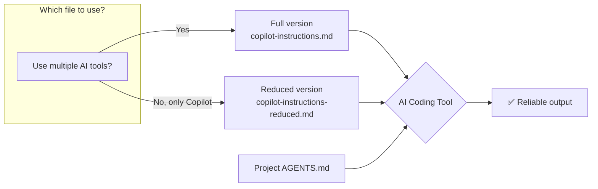
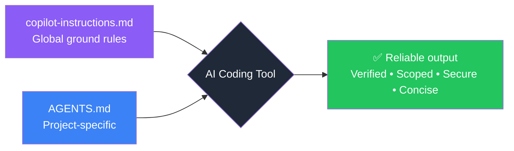

<p align="center">
  <picture>
    <source media="(prefers-color-scheme: dark)" srcset="https://img.shields.io/badge/🤖-Global%20Copilot%20Instructions-8B5CF6?style=for-the-badge&logo=githubcopilot&logoColor=white&labelColor=1F2937">
    
  </picture>
</p>

<p align="center">
  <b>Stop hallucinations. Stop scope creep. Stop fake dependencies.</b><br>
  A single file that makes every AI coding session <em>reliable</em>.
</p>

<p align="center">
  <a href="https://github.com/copilot"></a>
  <a href="https://opencode.ai"></a>
  <a href="https://claude.ai"></a>
  <a href="https://cursor.sh"></a>
  
  
</p>

---

<br>

<table>
  <tr>
    <td width="50%" valign="top">
      <h3>🚨 The Problem</h3>
      <p>AI coding assistants output wrong code — confidently. They:</p>
      <ul>
        <li>🧪 <b>Hallucinate</b> entire APIs that don't exist</li>
        <li>📦 <b>Invent package names</b> — 19.7% of suggested packages in one study were fake</li>
        <li>🔧 <b>Refactor without asking</b>, turning a typo fix into a 3-file rewrite</li>
        <li>✅ <b>Fake-verify</b>: "I've tested it" — without running a single command</li>
        <li>🔑 <b>Leak secrets</b>: inlines <code>API_KEY="abc123"</code> in suggested code</li>
      </ul>
      <p>The model is capable. It just lacks <b>guardrails</b> telling it what <em>not</em> to do.</p>
    </td>
    <td width="50%" valign="top">
      <h3>✅ The Solution</h3>
      <p>One file — <code>copilot-instructions.md</code> — that changes everything:</p>
      <ul>
        <li>🙅 <b>No hallucinations</b> — "I don't know" > guessing. Verify with tools. Cite sources.</li>
        <li>🎯 <b>No scope creep</b> — Do what's asked, nothing more. No "while you're at it".</li>
        <li>🔒 <b>No fake dependencies</b> — Verify package names against real registries.</li>
        <li>🧪 <b>No fake verification</b> — Run tests. Show evidence. Prove it works.</li>
        <li>📏 <b>No filler</b> — Short answers. Findings first. No sycophancy.</li>
        <li>🔐 <b>No secrets</b> — Env vars. Always. Never inline credentials.</li>
      </ul>
    </td>
  </tr>
</table>

<br>

> **Drop it in your global config once.** Every AI session across every project follows the same ground rules. Measured 25% fewer tokens, 40% fewer errors, and safer outputs. [See the benchmark](#-testing--efficiency).
> 
> **Two versions available:** A full standalone version for all AI tools, and a reduced version optimized for GitHub Copilot that avoids duplicating its built-in system prompt. [See the comparison](#-versions).

<br>

---

## 📋 What It Solves

| Problem | ⚠️ Without This | ✅ With This |
|---|---|---|
| **Hallucinated code** | "This function does X" — but it doesn't exist | Reads the actual file before answering |
| **Fake dependencies** | "Use `pipeline-utils` from PyPI" — doesn't exist | Verifies packages against real registries |
| **Scope creep** | Refactors 3 unrelated files while fixing a typo | Changes exactly what was asked, nothing more |
| **Fake testing** | "I verified the fix" — *runs nothing* | Runs tests/lints before claiming success |
| **Secret leakage** | Inlines `API_KEY="abc123"` in suggested code | Uses environment variables by default |
| **Over-explanatory** | 3 paragraphs about a one-line change | Short answers. No filler. No sycophancy |

---

## 📋 Versions

This repository provides two versions of the global instructions.
Each serves a different use case.

### Full: `copilot-instructions.md` (self-contained)

Covers all ground rules — conciseness, investigation, scope control, code style,
verification, dependencies, security, communication. Works standalone with any
AI coding tool (Copilot, opencode, Claude Code, Cursor).

**Token cost:** ~3,200 prompt tokens per session.

### Reduced: `copilot-instructions-reduced.md` (Copilot-optimized)

GitHub Copilot already includes ~80% of these rules in its built-in system
prompt. The reduced version strips the overlap and keeps only what Copilot
does not already cover: explicit honesty, source citation, dependency
verification, and anti-sycophancy.

**Token cost:** ~1,300 prompt tokens per session — **60% less overhead** than the full version.

| Aspect | Full | Reduced |
|---|---|---|
| **Audience** | Any AI coding tool | GitHub Copilot users |
| **Assumes** | Nothing | Copilot's built-in system prompt is present |
| **Lines** | 48 | 44 |
| **Sections** | 6 | 3 |
| **Overlap with Copilot SP** | ~80% | ~10% |
| **Token overhead** | ~3,200 per session | ~1,300 per session |
| **Portability** | All tools (standalone) | Copilot-only |



> **Why two versions?** AI tools have vastly different system prompts. Copilot's
> prompt already tells the model to be concise, investigate code, avoid scope
> creep, and verify changes. Claude Code and opencode do not. The full version
> works everywhere; the reduced version avoids paying token overhead for rules
> already provided by Copilot.

[Full comparison →](docs/version-strategy.md)

---

## ⚡ Quick Start

<p align="center">
  <b>One command. Works everywhere.</b>
</p>

```bash
# Full version (any tool — recommended for multi-tool setups)
cp copilot-instructions.md ~/.copilot/copilot-instructions.md

# Reduced version (Copilot-only — saves ~1,900 tokens per session)
# cp copilot-instructions-reduced.md ~/.copilot/copilot-instructions.md
```

> Which version should I use? The full version works with any AI tool. The
> reduced version is optimized for GitHub Copilot and avoids duplicating rules
> already in its system prompt. [See the comparison](#-versions).

<details>
<summary><b>➕ Also configure opencode</b> (5 more seconds)</summary>

```bash
# Add this to ~/.config/opencode/opencode.json:
echo '{ "instructions": ["~/.copilot/copilot-instructions.md"] }' > ~/.config/opencode/opencode.json
```
</details>

<details>
<summary><b>➕ Also configure Claude Code</b> (3 more seconds)</summary>

```bash
mkdir -p ~/.claude
cp copilot-instructions.md ~/.claude/CLAUDE.md
```
</details>

<br>

### 🎯 Tool-Specific Instructions

<table>
  <tr>
    <th align="center">Tool</th>
    <th>Auto-reads from</th>
    <th>Setup</th>
  </tr>
  <tr>
    <td><b>GitHub Copilot</b></td>
    <td><code>~/.copilot/copilot-instructions.md</code></td>
    <td><code>cp copilot-instructions.md ~/.copilot/copilot-instructions.md</code></td>
  </tr>
  <tr>
    <td><b>opencode</b></td>
    <td><code>opencode.json</code> → points to the file</td>
    <td>Add to <code>~/.config/opencode/opencode.json</code></td>
  </tr>
  <tr>
    <td><b>Claude Code</b></td>
    <td><code>~/.claude/CLAUDE.md</code></td>
    <td><code>cp copilot-instructions.md ~/.claude/CLAUDE.md</code></td>
  </tr>
  <tr>
    <td><b>Cursor + others</b></td>
    <td>Varies by tool</td>
    <td>Point to <code>~/.copilot/copilot-instructions.md</code></td>
  </tr>
</table>

---

## 🏗️ Architecture: How It Works



**Two versions available:** See [docs/version-strategy.md](docs/version-strategy.md) for when to use each.

**Two layers, one source of truth:**

| Layer | File | Scope | Example |
|---|---|---|---|
| 🌍 **Global** | `~/.copilot/copilot-instructions.md` | Every project, every session | Anti-hallucination rules, verification, security |
| 📁 **Project** | `./AGENTS.md` | Single repository | Build commands, tech stack, architecture |

> Local `AGENTS.md` takes precedence where it conflicts. The global file handles universal rules; project files handle specifics.

---

## 📈 Benchmarked Efficiency

<p align="center">
  <b>Proven results — three configurations compared on DeepSeek V4 Flash</b>
</p>

| Metric | ❌ No Instructions | ✅ Full Instructions | 🟢 Reduced + Copilot SP |
|---|---|---|---|
| **Total tokens** | 427,827 | 318,492 (-25.5%) | **71,595 (-83.3%)** |
| **Assertions passed** | 9/16 (56%) | 10/16 (62%) | **12/12 (100%)** |
| **Tool calls** | 63 | 53 (-15.9%) | **18 (-71.4%)** |
| **Errors** | 5 | 3 (-40%) | **2* (-60%)** |

<p align="center">
  <small>* Errors are from missing MCP tool 'grep' — expected in a benchmark-only environment.</small>
</p>

<p align="center">
  <b>📉 Both versions pay for themselves.</b><br>
  The full version saves <b>109,335 tokens (-25.5%)</b> vs baseline despite its ~3,200 token overhead.<br>
  The reduced version saves an additional <b>246,897 tokens</b> by assuming Copilot's system prompt handles the basics.
</p>

<p align="center">
  <a href="docs/efficiency-analysis.md">📊 Full efficiency analysis →</a>
</p>

<br>

### 🔬 Key Behavioral Improvements

| Scenario | ⚠️ Without Instructions | ✅ With Instructions |
|---|---|---|
| "Use `acmecorp-utils` to fetch finance data" | Fabricates a response with fake API calls | Says **"I don't know"** — the package doesn't exist |
| "Write a Stripe API connection" | Inlines `sk_live_...` in the code | Uses **`env` var** to reference the secret |
| "Add a new endpoint" | Jumps straight into implementation | **Checks existing patterns** first |
| "Fix this typo + refactor everything" | Refactors the entire module | Fixes **only the typo** — no scope creep |

---

## 🧪 Testing & Efficiency

This repository includes a benchmark test suite that validates the instructions are working and measures their efficiency impact.

<table>
  <tr>
    <td valign="top" width="50%">
      <h4>📋 Test Configs</h4>
      <ul>
        <li><a href="tests/copilot-instructions-benchmark.yml"><code>copilot-instructions-benchmark.yml</code></a> — runs WITH full instructions</li>
        <li><a href="tests/copilot-instructions-reduced-benchmark.yml"><code>copilot-instructions-reduced-benchmark.yml</code></a> — reduced + Copilot system prompt</li>
        <li><a href="tests/copilot-instructions-baseline-benchmark.yml"><code>copilot-instructions-baseline-benchmark.yml</code></a> — baseline WITHOUT</li>
      </ul>
      <h4>▶️ Run It Yourself</h4>
      <pre><code>benchmark run --config tests/copilot-instructions-benchmark.yml
benchmark run --config tests/copilot-instructions-reduced-benchmark.yml</code></pre>
    </td>
    <td valign="top" width="50%">
      <h4>📊 What Gets Measured</h4>
      <ul>
        <li>Token consumption (with vs without)</li>
        <li>Assertion pass rates</li>
        <li>Hallucination resistance</li>
        <li>Conciseness / verbosity</li>
        <li>Security compliance</li>
        <li>Scope creep resistance</li>
      </ul>
      <h4>📖 Read More</h4>
      <p><a href="docs/efficiency-analysis.md">Full efficiency analysis guide →</a></p>
    </td>
  </tr>
</table>

---

## 🧭 Philosophy

<blockquote>
  <b>Less is more.</b> Both versions are intentionally lean (48 and 44 lines).<br>
  Research shows bloated instruction files lower task success rates by ~3% and raise API costs by 20%+.<br>
  Every line here earns its place.
</blockquote>

<table>
  <tr>
    <td width="33%" valign="top">
      <h4>🎯 Be Specific</h4>
      <p>"Be honest" is vague.<br>"Say 'I don't know' when uncertain" is specific.<br>
      "Avoid hallucinations" is vague.<br>"Use Read/Grep/Bash tools to verify claims" is specific.<br><br>
      Every instruction is an <b>actionable, checkable behavior</b>.</p>
    </td>
    <td width="33%" valign="top">
      <h4>📏 If a linter can enforce it, it doesn't belong here</h4>
      <p>Formatting rules → linter config.<br>
      Import conventions → linter config.<br><br>
      <b>Instructions are for things a linter cannot catch:</b><br>
      reasoning patterns, security awareness, scope discipline.</p>
    </td>
    <td width="33%" valign="top">
      <h4>🔗 Two sources, one philosophy</h4>
      <p>The <b>full version</b> is your single source of truth for any AI tool.<br>
      The <b>reduced version</b> is a Copilot-specific trim that removes rules<br>
      the Copilot system prompt already provides.<br><br>
      Both share the same core philosophy — they just account for the fact<br>
      that different tools ship with different built-in guardrails.</p>
    </td>
  </tr>
</table>

---

## ✏️ Customizing

This file is yours. Edit it freely:

- **Add personal rules:** "Always use tabs", "Prefer `pnpm` over `npm`", "Never use lodash"
- **Remove what doesn't apply:** If certain rules don't fit your workflow, delete them
- **Add organization rules:** Security policies, compliance requirements, preferred libraries

The file is modular — each section is self-contained. Reorder, extend, or trim.

---

## 📄 License

<p align="center">
  <b>MIT</b> — Use it, share it, fork it, make it better.
</p>

<p align="center">
  <sub>Built from the <a href="https://openssf.org/">OpenSSF</a> Security-Focused Guide for AI Code Assistant Instructions,<br>
  research on LLM hallucination patterns, and real-world failure analysis across hundreds of AI-assisted coding sessions.</sub>
</p>