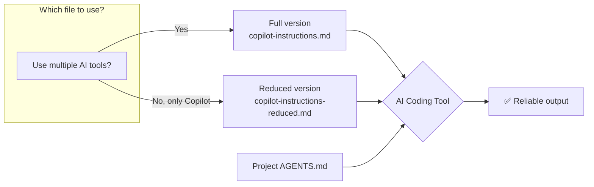
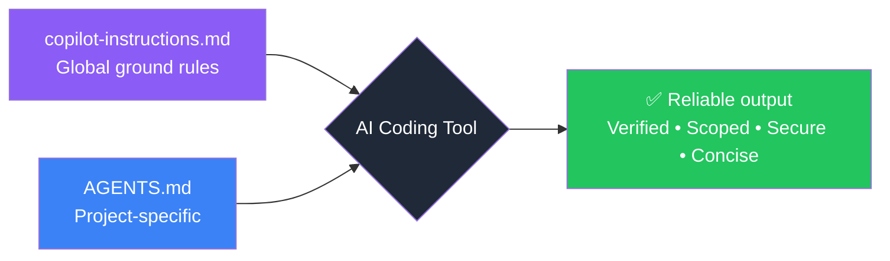

<p align="center">
  <picture>
    <source media="(prefers-color-scheme: dark)" srcset="https://img.shields.io/badge/🤖-Global%20Copilot%20Instructions-8B5CF6?style=for-the-badge&logo=githubcopilot&logoColor=white&labelColor=1F2937">
    
  </picture>
</p>

<p align="center">
  <b>Stop hallucinations. Stop scope creep. Stop fake dependencies.</b><br>
  Evidence-first guardrails and an optional reusable development cycle.
</p>

<p align="center">
  <a href="https://github.com/copilot"></a>
  <a href="https://opencode.ai"></a>
  <a href="https://claude.ai"></a>
  <a href="https://cursor.sh"></a>
  
</p>

---

<br>

<table>
  <tr>
    <td width="50%" valign="top">
      <h3>🚨 The Problem</h3>
      <p>AI coding assistants output wrong code — confidently. They:</p>
      <ul>
        <li>🧪 <b>Hallucinate</b> entire APIs that don't exist</li>
        <li>📦 <b>Invent package names</b> — 19.7% of suggested packages in one study were fake</li>
        <li>🔧 <b>Refactor without asking</b>, turning a typo fix into a 3-file rewrite</li>
        <li>✅ <b>Fake-verify</b>: "I've tested it" — without running a single command</li>
        <li>🔑 <b>Leak secrets</b>: inlines <code>API_KEY="abc123"</code> in suggested code</li>
      </ul>
      <p>The model is capable. It just lacks <b>guardrails</b> telling it what <em>not</em> to do.</p>
    </td>
    <td width="50%" valign="top">
      <h3>✅ The Solution</h3>
      <p>One file — <code>copilot-instructions.md</code> — that changes everything:</p>
      <ul>
        <li>🙅 <b>Evidence before answers</b> — Check available tools. Cite real sources. Explain what remains unknown.</li>
        <li>🎯 <b>No scope creep</b> — Do what's asked, nothing more. No "while you're at it".</li>
        <li>🔒 <b>No fake dependencies</b> — Verify package names against real registries.</li>
        <li>🧪 <b>No fake verification</b> — Run tests. Show evidence. Prove it works.</li>
        <li>📏 <b>No filler</b> — Short answers. Findings first. No sycophancy.</li>
        <li>🔐 <b>No secrets</b> — Env vars. Always. Never inline credentials.</li>
      </ul>
    </td>
  </tr>
</table>

<br>

> **Install shared ground rules once.** They guide sessions across projects; they do not guarantee correctness. The older benchmark results below describe previous instructions, not a measurement of the current files. [See the evaluation limits](docs/efficiency-analysis.md).
> 
> **Two versions available:** A full standalone version for all AI tools, and a reduced version optimized for GitHub Copilot that avoids duplicating its built-in system prompt. [See the comparison](#-versions).

<br>

---

## 📋 What It Solves

| Problem | ⚠️ Without This | ✅ With This |
|---|---|---|
| **Hallucinated code** | "This function does X" — but it doesn't exist | Reads the actual file before answering |
| **Fake dependencies** | "Use `pipeline-utils` from PyPI" — doesn't exist | Verifies packages against real registries |
| **Scope creep** | Refactors 3 unrelated files while fixing a typo | Changes exactly what was asked, nothing more |
| **Fake testing** | "I verified the fix" — *runs nothing* | Runs tests/lints before claiming success |
| **Secret leakage** | Inlines `API_KEY="abc123"` in suggested code | Uses environment variables by default |
| **Over-explanatory** | 3 paragraphs about a one-line change | Short answers. No filler. No sycophancy |

---

## 📋 Versions

This repository provides two versions of the global instructions.
Each serves a different use case.

### Full: `copilot-instructions.md` (self-contained)

Covers all ground rules — conciseness, investigation, scope control, code style,
verification, dependencies, security, communication. Works standalone with any
AI coding tool (Copilot, opencode, Claude Code, Cursor).

Includes investigation, scope control, verification, and the optional
development-cycle routing policy.

### Reduced: `copilot-instructions-reduced.md` (Copilot-optimized)

GitHub Copilot supplies many general development rules in its built-in system
prompt. The reduced version avoids repeating them and focuses on evidence
handling, source citation, dependency verification, anti-sycophancy, and
optional development-cycle routing.

Keeps the evidence policy and optional development-cycle routing while leaving
general investigation and verification rules to the host.

| Aspect | Full | Reduced |
|---|---|---|
| **Audience** | Any AI coding tool | GitHub Copilot users |
| **Assumes** | Nothing | Copilot's built-in system prompt is present |
| **Evidence policy** | Check available tools, cite evidence, explain limits | Same |
| **Development cycle** | Optional skill routing | Same |
| **Portability** | All tools (standalone) | Copilot-only |



> **Why two versions?** AI tools have vastly different system prompts. Copilot's
> prompt already tells the model to be concise, investigate code, avoid scope
> creep, and verify changes. Other tools and versions can provide different
> defaults. The full version is self-contained; the reduced version avoids
> repeating general rules supplied by the host.

[Full comparison →](docs/version-strategy.md)

---

## ⚡ Quick Start

<p align="center">
  <b>One command. Works everywhere.</b>
</p>

```bash
# Full version (any tool — recommended for multi-tool setups)
# For a fresh installation only; merge with an existing customized file.
cp copilot-instructions.md ~/.copilot/copilot-instructions.md

# Reduced version (Copilot-only)
# cp copilot-instructions-reduced.md ~/.copilot/copilot-instructions.md
```

Already have personal instructions? Compare and merge rather than overwrite.
Preserve machine-specific toolchain settings. In particular, replace any rule
that assumes external access is always unavailable: inspect available
authorized tools first, then answer from evidence or explain the actual limit.

> Which version should I use? The full version works with any AI tool. The
> reduced version is optimized for GitHub Copilot and avoids duplicating rules
> already in its system prompt. [See the comparison](#-versions).

<details>
<summary><b>➕ Also configure opencode</b> (5 more seconds)</summary>

```bash
# Add this to ~/.config/opencode/opencode.json:
echo '{ "instructions": ["~/.copilot/copilot-instructions.md"] }' > ~/.config/opencode/opencode.json
```
</details>

<details>
<summary><b>➕ Also configure Claude Code</b> (3 more seconds)</summary>

```bash
mkdir -p ~/.claude
cp copilot-instructions.md ~/.claude/CLAUDE.md
```
</details>

<br>

### 🎯 Tool-Specific Instructions

<table>
  <tr>
    <th align="center">Tool</th>
    <th>Auto-reads from</th>
    <th>Setup</th>
  </tr>
  <tr>
    <td><b>GitHub Copilot</b></td>
    <td><code>~/.copilot/copilot-instructions.md</code></td>
    <td><code>cp copilot-instructions.md ~/.copilot/copilot-instructions.md</code></td>
  </tr>
  <tr>
    <td><b>opencode</b></td>
    <td><code>opencode.json</code> → points to the file</td>
    <td>Add to <code>~/.config/opencode/opencode.json</code></td>
  </tr>
  <tr>
    <td><b>Claude Code</b></td>
    <td><code>~/.claude/CLAUDE.md</code></td>
    <td><code>cp copilot-instructions.md ~/.claude/CLAUDE.md</code></td>
  </tr>
  <tr>
    <td><b>Cursor + others</b></td>
    <td>Varies by tool</td>
    <td>Point to <code>~/.copilot/copilot-instructions.md</code></td>
  </tr>
</table>

---

## 🏗️ Architecture: How It Works



**Two versions available:** See [docs/version-strategy.md](docs/version-strategy.md) for when to use each.

**Shared policy, project context, and an optional process:**

| Layer | File | Scope | Example |
|---|---|---|---|
| 🌍 **Global** | `~/.copilot/copilot-instructions.md` | Every project, every session | Anti-hallucination rules, verification, security |
| 📁 **Project** | `./AGENTS.md` | Single repository | Build commands, tech stack, architecture |
| 🔄 **On-demand skill** | `~/.copilot/skills/development-cycle/SKILL.md` | User-authorized implementation | Scoped work, review, triage, bounded remediation |

> Follow the host's instruction precedence. The global file handles shared
> policy; project guidance handles specifics; the skill supplies the process
> only when relevant.

### Reusable development cycle

The optional [development-cycle skill](skills/development-cycle/SKILL.md)
implements the process discussed for reusable subagent development:
scoped implementation, independent read-only review when warranted,
evidence-based triage, and one remediation/re-review cycle before surfacing
unresolved findings. Small tasks stay direct; workers never recursively start
the cycle.

```bash
mkdir -p ~/.copilot/skills
cp -R skills/development-cycle ~/.copilot/skills/
```

Review an existing skill before replacing it. Reload skills or start a new
session and verify discovery. The global routing section does not install
anything, launch a Dynamic Workflow, or authorize publication.
[Installation, model preferences, and workflow boundaries →](docs/development-cycle.md)

---

## 📈 Historical Benchmark Results

<p align="center">
  <b>Previously reported results — not re-run for the current instructions</b>
</p>

These June 2026 figures are retained as historical reports. Raw captures are
not included in this repository. The reduced suite used different prompts and
rewarded automatic refusals, so the three columns are not a controlled
comparison of instruction efficiency or current behavior.

| Metric | ❌ No Instructions | ✅ Full Instructions | 🟢 Reduced + Copilot SP |
|---|---|---|---|
| **Total tokens** | 427,827 | 318,492 (-25.5%) | **71,595 (-83.3%)** |
| **Assertions passed** | 9/16 (56%) | 10/16 (62%) | **12/12 (100%)** |
| **Tool calls** | 63 | 53 (-15.9%) | **18 (-71.4%)** |
| **Errors** | 5 | 3 (-40%) | **2* (-60%)** |

<p align="center">
  <small>* Errors are from missing MCP tool 'grep' — expected in a benchmark-only environment.</small>
</p>

<p align="center">
  <b>Measure useful outcomes, not refusals.</b><br>
  Fewer tokens do not establish correctness or prove that a multi-agent cycle is cheaper.
</p>

<p align="center">
  <a href="docs/efficiency-analysis.md">📊 Full efficiency analysis →</a>
</p>

<br>

### 🔬 Key Behavioral Improvements

| Scenario | ⚠️ Without Instructions | ✅ With Instructions |
|---|---|---|
| "Use `acmecorp-utils` to fetch finance data" | Assumes the package and API exist | Verifies registry and documentation when possible; otherwise explains the missing evidence |
| "Write a Stripe API connection" | Inlines `sk_live_...` in the code | Uses **`env` var** to reference the secret |
| "Add a new endpoint" | Jumps straight into implementation | **Checks existing patterns** first |
| "Fix this typo + refactor everything" | Refactors the entire module | Fixes **only the typo** — no scope creep |

---

## 🧪 Testing & Efficiency

This repository includes response-level benchmark smoke tests and
[trace-based behavior checks](tests/behavior-regressions.md). Keyword matches
alone do not validate tool use or independent review.

<table>
  <tr>
    <td valign="top" width="50%">
      <h4>📋 Test Configs</h4>
      <ul>
        <li><a href="tests/copilot-instructions-benchmark.yml"><code>copilot-instructions-benchmark.yml</code></a> — runs WITH full instructions</li>
        <li><a href="tests/copilot-instructions-reduced-benchmark.yml"><code>copilot-instructions-reduced-benchmark.yml</code></a> — reduced + Copilot system prompt</li>
        <li><a href="tests/copilot-instructions-baseline-benchmark.yml"><code>copilot-instructions-baseline-benchmark.yml</code></a> — baseline WITHOUT</li>
      </ul>
      <h4>▶️ Run It Yourself</h4>
      <pre><code>benchmark run --config tests/copilot-instructions-benchmark.yml
benchmark run --config tests/copilot-instructions-reduced-benchmark.yml</code></pre>
    </td>
    <td valign="top" width="50%">
      <h4>📊 What Gets Measured</h4>
      <ul>
        <li>Token consumption (with vs without)</li>
        <li>Assertion pass rates</li>
        <li>Hallucination resistance</li>
        <li>Conciseness / verbosity</li>
        <li>Security compliance</li>
        <li>Scope creep resistance</li>
      </ul>
      <h4>📖 Read More</h4>
      <p><a href="docs/efficiency-analysis.md">Full efficiency analysis guide →</a></p>
    </td>
  </tr>
</table>

---

## 🧭 Philosophy

<blockquote>
  <b>Keep persistent policy short.</b><br>
  Load the detailed development cycle only when relevant, and measure the whole process before claiming savings.
</blockquote>

<table>
  <tr>
    <td width="33%" valign="top">
      <h4>🎯 Be Specific</h4>
      <p>"Be honest" is vague.<br>"Check available evidence before answering or refusing" is actionable.<br>
      "Avoid hallucinations" is vague.<br>"Cite only sources actually consulted" is checkable.<br><br>
      Every instruction is an <b>actionable, checkable behavior</b>.</p>
    </td>
    <td width="33%" valign="top">
      <h4>📏 If a linter can enforce it, it doesn't belong here</h4>
      <p>Formatting rules → linter config.<br>
      Import conventions → linter config.<br><br>
      <b>Instructions are for things a linter cannot catch:</b><br>
      reasoning patterns, security awareness, scope discipline.</p>
    </td>
    <td width="33%" valign="top">
      <h4>🔗 Two sources, one philosophy</h4>
      <p>The <b>full version</b> is your single source of truth for any AI tool.<br>
      The <b>reduced version</b> is a Copilot-specific trim that removes rules<br>
      the Copilot system prompt already provides.<br><br>
      Both share the same core philosophy — they just account for the fact<br>
      that different tools ship with different built-in guardrails.</p>
    </td>
  </tr>
</table>

---

## ✏️ Customizing

This file is yours. Edit it freely:

- **Add personal rules:** "Always use tabs", "Prefer `pnpm` over `npm`", "Never use lodash"
- **Remove what doesn't apply:** If certain rules don't fit your workflow, delete them
- **Add organization rules:** Security policies, compliance requirements, preferred libraries

The file is modular — each section is self-contained. Reorder, extend, or trim.

---

## 📄 License

<p align="center">
  <b>MIT</b> — Use it, share it, fork it, make it better.
</p>

<p align="center">
  <sub>Built from the <a href="https://openssf.org/">OpenSSF</a> Security-Focused Guide for AI Code Assistant Instructions,<br>
  research on LLM hallucination patterns, and real-world failure analysis across hundreds of AI-assisted coding sessions.</sub>
</p>