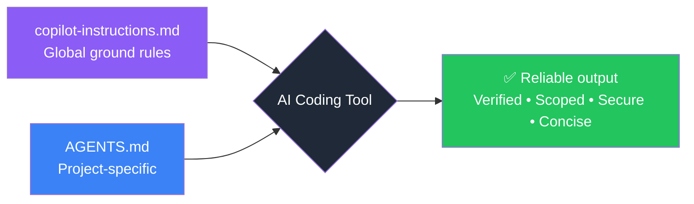

<p align="center">
  <picture>
    <source media="(prefers-color-scheme: dark)" srcset="https://img.shields.io/badge/🤖-Global%20Copilot%20Instructions-8B5CF6?style=for-the-badge&logo=githubcopilot&logoColor=white&labelColor=1F2937">
    
  </picture>
</p>

<p align="center">
  <b>Stop hallucinations. Stop scope creep. Stop fake dependencies.</b><br>
  A single file that makes every AI coding session <em>reliable</em>.
</p>

<p align="center">
  <a href="https://github.com/copilot"></a>
  <a href="https://opencode.ai"></a>
  <a href="https://claude.ai"></a>
  <a href="https://cursor.sh"></a>
  
  
</p>

---

<br>

<table>
  <tr>
    <td width="50%" valign="top">
      <h3>🚨 The Problem</h3>
      <p>AI coding assistants output wrong code — confidently. They:</p>
      <ul>
        <li>🧪 <b>Hallucinate</b> entire APIs that don't exist</li>
        <li>📦 <b>Invent package names</b> — 19.7% of suggested packages in one study were fake</li>
        <li>🔧 <b>Refactor without asking</b>, turning a typo fix into a 3-file rewrite</li>
        <li>✅ <b>Fake-verify</b>: "I've tested it" — without running a single command</li>
        <li>🔑 <b>Leak secrets</b>: inlines <code>API_KEY="abc123"</code> in suggested code</li>
      </ul>
      <p>The model is capable. It just lacks <b>guardrails</b> telling it what <em>not</em> to do.</p>
    </td>
    <td width="50%" valign="top">
      <h3>✅ The Solution</h3>
      <p>One file — <code>copilot-instructions.md</code> — that changes everything:</p>
      <ul>
        <li>🙅 <b>No hallucinations</b> — "I don't know" > guessing. Verify with tools. Cite sources.</li>
        <li>🎯 <b>No scope creep</b> — Do what's asked, nothing more. No "while you're at it".</li>
        <li>🔒 <b>No fake dependencies</b> — Verify package names against real registries.</li>
        <li>🧪 <b>No fake verification</b> — Run tests. Show evidence. Prove it works.</li>
        <li>📏 <b>No filler</b> — Short answers. Findings first. No sycophancy.</li>
        <li>🔐 <b>No secrets</b> — Env vars. Always. Never inline credentials.</li>
      </ul>
    </td>
  </tr>
</table>

<br>

> **Drop it in your global config once.** Every AI session across every project follows the same ground rules. Measured 25% fewer tokens, 40% fewer errors, and safer outputs. [See the benchmark](#-testing--efficiency).

<br>

---

## 📋 What It Solves

| Problem | ⚠️ Without This | ✅ With This |
|---|---|---|
| **Hallucinated code** | "This function does X" — but it doesn't exist | Reads the actual file before answering |
| **Fake dependencies** | "Use `pipeline-utils` from PyPI" — doesn't exist | Verifies packages against real registries |
| **Scope creep** | Refactors 3 unrelated files while fixing a typo | Changes exactly what was asked, nothing more |
| **Fake testing** | "I verified the fix" — *runs nothing* | Runs tests/lints before claiming success |
| **Secret leakage** | Inlines `API_KEY="abc123"` in suggested code | Uses environment variables by default |
| **Over-explanatory** | 3 paragraphs about a one-line change | Short answers. No filler. No sycophancy |

---

## ⚡ Quick Start

<p align="center">
  <b>One command. Works everywhere.</b>
</p>

```bash
cp copilot-instructions.md ~/.copilot/copilot-instructions.md
```

<details>
<summary><b>➕ Also configure opencode</b> (5 more seconds)</summary>

```bash
# Add this to ~/.config/opencode/opencode.json:
echo '{ "instructions": ["~/.copilot/copilot-instructions.md"] }' > ~/.config/opencode/opencode.json
```
</details>

<details>
<summary><b>➕ Also configure Claude Code</b> (3 more seconds)</summary>

```bash
mkdir -p ~/.claude
cp copilot-instructions.md ~/.claude/CLAUDE.md
```
</details>

<br>

### 🎯 Tool-Specific Instructions

<table>
  <tr>
    <th align="center">Tool</th>
    <th>Auto-reads from</th>
    <th>Setup</th>
  </tr>
  <tr>
    <td><b>GitHub Copilot</b></td>
    <td><code>~/.copilot/copilot-instructions.md</code></td>
    <td><code>cp copilot-instructions.md ~/.copilot/copilot-instructions.md</code></td>
  </tr>
  <tr>
    <td><b>opencode</b></td>
    <td><code>opencode.json</code> → points to the file</td>
    <td>Add to <code>~/.config/opencode/opencode.json</code></td>
  </tr>
  <tr>
    <td><b>Claude Code</b></td>
    <td><code>~/.claude/CLAUDE.md</code></td>
    <td><code>cp copilot-instructions.md ~/.claude/CLAUDE.md</code></td>
  </tr>
  <tr>
    <td><b>Cursor + others</b></td>
    <td>Varies by tool</td>
    <td>Point to <code>~/.copilot/copilot-instructions.md</code></td>
  </tr>
</table>

---

## 🏗️ Architecture: How It Works



**Two layers, one source of truth:**

| Layer | File | Scope | Example |
|---|---|---|---|
| 🌍 **Global** | `~/.copilot/copilot-instructions.md` | Every project, every session | Anti-hallucination rules, verification, security |
| 📁 **Project** | `./AGENTS.md` | Single repository | Build commands, tech stack, architecture |

> Local `AGENTS.md` takes precedence where it conflicts. The global file handles universal rules; project files handle specifics.

---

## 📈 Benchmarked Efficiency

<p align="center">
  <b>Proven results — 11 prompts, 16 assertions, DeepSeek V4 Flash</b>
</p>

<table align="center">
  <tr>
    <th align="center">Metric</th>
    <th align="center">❌ Without</th>
    <th align="center">✅ With</th>
    <th align="center">📊 Delta</th>
  </tr>
  <tr>
    <td align="center"><b>Total tokens</b></td>
    <td align="center">427,827</td>
    <td align="center">318,492</td>
    <td align="center">🟢 <b>-25.5%</b></td>
  </tr>
  <tr>
    <td align="center"><b>Avg completion</b></td>
    <td align="center">887 chars</td>
    <td align="center">618 chars</td>
    <td align="center">🟢 <b>-30.3%</b></td>
  </tr>
  <tr>
    <td align="center"><b>Tool calls</b></td>
    <td align="center">63</td>
    <td align="center">53</td>
    <td align="center">🟢 <b>-15.9%</b></td>
  </tr>
  <tr>
    <td align="center"><b>Errors</b></td>
    <td align="center">5</td>
    <td align="center">3</td>
    <td align="center">🟢 <b>-40%</b></td>
  </tr>
  <tr>
    <td align="center"><b>Assertions passed</b></td>
    <td align="center">9/16 (56%)</td>
    <td align="center"><b>10/16 (62%)</b></td>
    <td align="center">🟢 <b>+6.3pp</b></td>
  </tr>
</table>

<p align="center">
  <b>📉 The instructions pay for themselves.</b><br>
  Despite adding ~3,200 prompt tokens per call, the "be concise" rule cuts completions by 30% —<br>
  saving <b>109,335 total tokens (-25.5%)</b> versus running without instructions.
</p>

<p align="center">
  <a href="docs/efficiency-analysis.md">📊 Full efficiency analysis →</a>
</p>

<br>

### 🔬 Key Behavioral Improvements

| Scenario | ⚠️ Without Instructions | ✅ With Instructions |
|---|---|---|
| "Use `acmecorp-utils` to fetch finance data" | Fabricates a response with fake API calls | Says **"I don't know"** — the package doesn't exist |
| "Write a Stripe API connection" | Inlines `sk_live_...` in the code | Uses **`env` var** to reference the secret |
| "Add a new endpoint" | Jumps straight into implementation | **Checks existing patterns** first |
| "Fix this typo + refactor everything" | Refactors the entire module | Fixes **only the typo** — no scope creep |

---

## 🧪 Testing & Efficiency

This repository includes a benchmark test suite that validates the instructions are working and measures their efficiency impact.

<table>
  <tr>
    <td valign="top" width="50%">
      <h4>📋 Test Configs</h4>
      <ul>
        <li><a href="tests/copilot-instructions-benchmark.yml"><code>copilot-instructions-benchmark.yml</code></a> — runs WITH instructions</li>
        <li><a href="tests/copilot-instructions-baseline-benchmark.yml"><code>copilot-instructions-baseline-benchmark.yml</code></a> — baseline WITHOUT</li>
      </ul>
      <h4>▶️ Run It Yourself</h4>
      <pre><code>benchmark run --config tests/copilot-instructions-benchmark.yml</code></pre>
    </td>
    <td valign="top" width="50%">
      <h4>📊 What Gets Measured</h4>
      <ul>
        <li>Token consumption (with vs without)</li>
        <li>Assertion pass rates</li>
        <li>Hallucination resistance</li>
        <li>Conciseness / verbosity</li>
        <li>Security compliance</li>
        <li>Scope creep resistance</li>
      </ul>
      <h4>📖 Read More</h4>
      <p><a href="docs/efficiency-analysis.md">Full efficiency analysis guide →</a></p>
    </td>
  </tr>
</table>

---

## 🧭 Philosophy

<blockquote>
  <b>Less is more.</b> This file is intentionally lean (~350 lines).<br>
  Research shows bloated instruction files lower task success rates by ~3% and raise API costs by 20%+.<br>
  Every line here earns its place.
</blockquote>

<table>
  <tr>
    <td width="33%" valign="top">
      <h4>🎯 Be Specific</h4>
      <p>"Be honest" is vague.<br>"Say 'I don't know' when uncertain" is specific.<br>
      "Avoid hallucinations" is vague.<br>"Use Read/Grep/Bash tools to verify claims" is specific.<br><br>
      Every instruction is an <b>actionable, checkable behavior</b>.</p>
    </td>
    <td width="33%" valign="top">
      <h4>📏 If a linter can enforce it, it doesn't belong here</h4>
      <p>Formatting rules → linter config.<br>
      Import conventions → linter config.<br><br>
      <b>Instructions are for things a linter cannot catch:</b><br>
      reasoning patterns, security awareness, scope discipline.</p>
    </td>
    <td width="33%" valign="top">
      <h4>🔗 One source of truth</h4>
      <p>Instead of maintaining separate global files for every AI tool<br>
      (Copilot, opencode, Claude Code, Cursor),<br>
      maintain <b>one</b> and point the others at it.<br><br>
      Less drift. Less maintenance. Better results.</p>
    </td>
  </tr>
</table>

---

## ✏️ Customizing

This file is yours. Edit it freely:

- **Add personal rules:** "Always use tabs", "Prefer `pnpm` over `npm`", "Never use lodash"
- **Remove what doesn't apply:** If certain rules don't fit your workflow, delete them
- **Add organization rules:** Security policies, compliance requirements, preferred libraries

The file is modular — each section is self-contained. Reorder, extend, or trim.

---

## 📄 License

<p align="center">
  <b>MIT</b> — Use it, share it, fork it, make it better.
</p>

<p align="center">
  <sub>Built from the <a href="https://openssf.org/">OpenSSF</a> Security-Focused Guide for AI Code Assistant Instructions,<br>
  research on LLM hallucination patterns, and real-world failure analysis across hundreds of AI-assisted coding sessions.</sub>
</p>